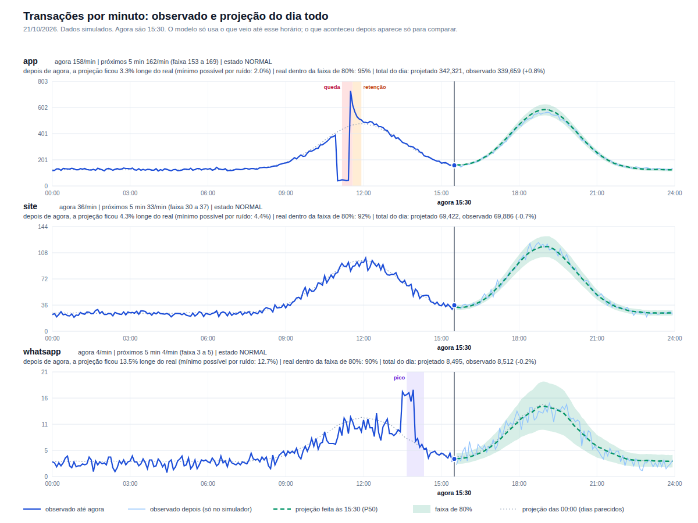
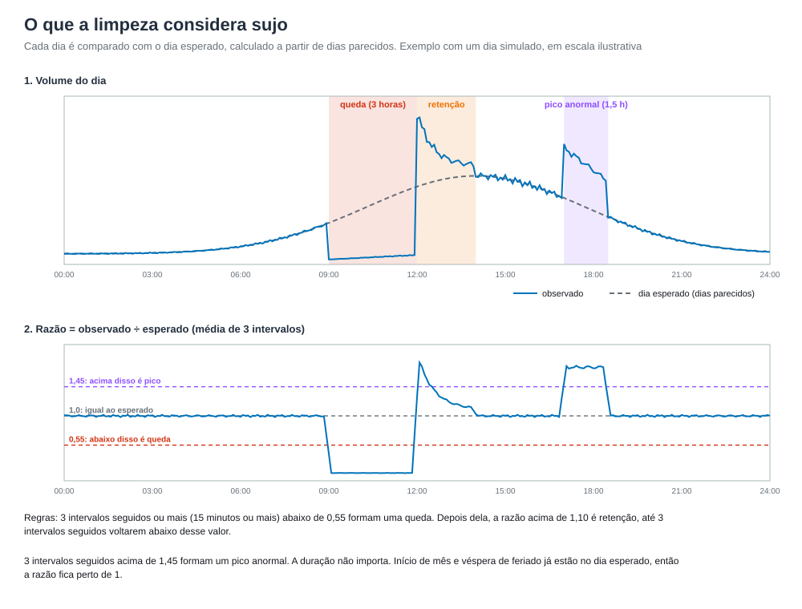
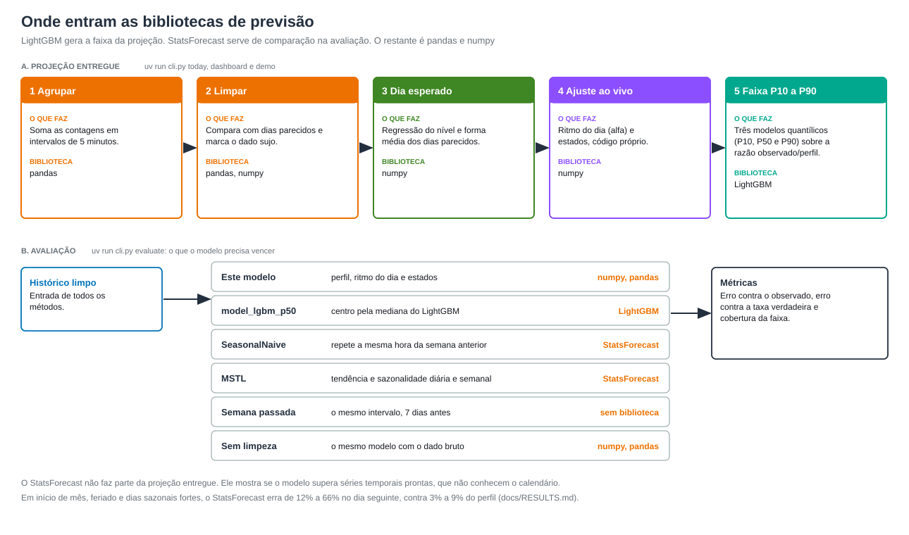
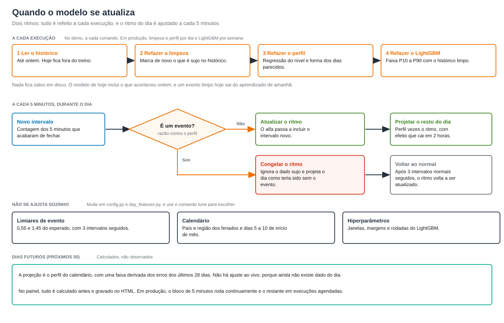

# sanecast

Projeção de volume de transações com limpeza automática do histórico.

O sanecast é um projeto de demonstração que mostra como gerar projeções mais assertivas de séries de contagem (transações, pedidos,
acessos) a partir do histórico. O exemplo usa a contagem de transações por minuto em três canais fictícios: app, site e whatsapp.
O projeto projeta o restante do dia a cada 5 minutos e os 30 dias seguintes, com uma faixa de incerteza.

O foco está no tratamento do dado. Um incidente derruba o volume e, em seguida, gera um pico de transações represadas. Um pico
anormal, como o de uma campanha, eleva o volume sem motivo de calendário. O modelo identifica os dois casos sem receber marcação e
sem presumir duração, exclui esses trechos do aprendizado e projeta o volume que o dia teria tido. O modelo também reconhece feriados
e outros dias sazonais pelo calendário. O mesmo método se aplica a outras séries de contagem com padrão diário, semanal e de calendário.

O projeto é uma demonstração, criada como referência e inspiração, e não como solução pronta para produção. Ele usa dados simulados e
inclui um painel em HTML para visualizar o resultado. Uma implementação em produção exige camadas de entrada e tratamento de dados, armazenamento, execução agendada e consulta, descritas em
[docs/ARCHITECTURE.md](docs/ARCHITECTURE.md).

**Painel de exemplo:** [https://johnnytardin.github.io/sanecast/demo/](https://johnnytardin.github.io/sanecast/demo/). O painel abre
no navegador, sem instalação, e usa dados simulados.


## Conteúdo

- [Pré-requisitos](#pré-requisitos)
- [Início rápido](#início-rápido)
- [Como o modelo funciona](#como-o-modelo-funciona)
- [Atualização do modelo e dados futuros](#atualização-do-modelo-e-dados-futuros)
- [Comandos](#comandos)
- [Entradas e saídas](#entradas-e-saídas)
- [Resultados nos dados simulados](#resultados-nos-dados-simulados)
- [Adaptação a dados reais](#adaptação-a-dados-reais)
- [Limitações](#limitações)
- [Estrutura do repositório](#estrutura-do-repositório)
- [Documentação](#documentação)

## Pré-requisitos

- [uv](https://docs.astral.sh/uv/getting-started/installation/) ou Docker com Compose.
- Python 3.10 a 3.13. O uv instala a versão necessária quando ela não está disponível.
- macOS: OpenMP para o LightGBM (`brew install libomp`).
- Windows: use Docker ou WSL.

Não é necessário ter dados reais. O projeto inclui um simulador.

## Início rápido

O comando `demo` simula os dados, mede o erro do modelo, desenha o gráfico de hoje e monta o painel. A execução leva cerca de 2 minutos.

1. Clone o repositório ([github.com/johnnytardin/sanecast](https://github.com/johnnytardin/sanecast)):

   ```bash
   git clone https://github.com/johnnytardin/sanecast
   cd sanecast
   ```

2. Execute o `demo` com Docker Compose ou com uv.

   **Docker Compose**

   ```bash
   mkdir -p data out
   docker compose run --rm forecast demo
   ```

   A primeira execução constrói a imagem e leva alguns minutos. Os dados ficam em `./data` e as saídas em `./out`. Se o seu usuário
   não for o 1000, informe o seu para que os arquivos gerados fiquem em seu nome:
   `HOST_UID=$(id -u) HOST_GID=$(id -g) docker compose run --rm forecast demo`.

   Os outros comandos seguem o mesmo formato:

   ```bash
   docker compose run --rm forecast evaluate    # erro do modelo e das comparações
   docker compose run --rm forecast dashboard   # somente o painel
   docker compose run --rm test                 # testes
   ```

   **uv**

   ```bash
   uv sync                  # cria o .venv com as versões do uv.lock
   uv run cli.py demo
   ```

   Todos os comandos seguem o formato `uv run cli.py <comando>`. O `uv run` sincroniza o ambiente quando o `pyproject.toml` muda,
   portanto o `uv sync` é opcional. Para atualizar as versões, use `uv lock --upgrade`. Para adicionar uma biblioteca, use
   `uv add <nome>`. Se a sua rede usa um certificado próprio e o uv retorna erro de certificado, acrescente `--system-certs`.

3. Abra `out/dashboard.html` no navegador.

O painel abre no dia de referência (o último dia do histórico), com a linha "agora" em um horário inicial fixo, e mostra os 7 dias
anteriores, o dia de referência e os 30 dias seguintes, por canal. O seletor de dia lista todas as datas, e o botão "Voltar ao horário
inicial" restaura a visão inicial. Os botões de granularidade vão de 1 minuto a 1 dia, com 5 minutos como padrão, e o horário "agora" vai até 23:55.
O modelo calcula em intervalos de 5 minutos. O cálculo de cada granularidade está em
[docs/METHOD.md](docs/METHOD.md#granularidade-do-painel-templatesdashboardhtml).

O GitHub Pages publica a pasta `docs/` (Settings → Pages → Deploy from a branch → `main` e `/docs`). O painel fica em `docs/demo/index.html`
e a página inicial em `docs/index.html`. A cópia do painel vem do `out/dashboard.html` gerado pelo `demo`. Para atualizá-la, execute o `demo` novamente
e copie `out/dashboard.html` para esse caminho. O gráfico do dia tem este formato:



### Arquivos gerados


| Arquivo | Conteúdo | Gerado por | Lido por |
|---|---|---|---|
| `data/transactions_1min.csv` | Contagem por minuto, canal e dia, até hoje. É a única entrada do modelo e a única que existe com dados reais | `simulate` | `evaluate`, `today`, `dashboard`, `tune` |
| `data/truth_1min.csv` | Gabarito da simulação: taxa verdadeira e minutos afetados por evento. Serve para medir o acerto | `simulate` | `evaluate`, `tune` e os testes. O modelo não lê esse arquivo |
| `data/future_1min.csv` | Os 30 dias depois de hoje, sorteados à parte, usados somente para comparar com a projeção | `simulate` | `dashboard` |
| `data/reference/` | Cópia fixa dos dados simulados (`REFERENCE_DAY` em `sanecast/simulate.py`), que mantém os testes independentes do relógio | testes | testes |
| `out/metrics.csv`, `out/coverage.csv` | Erro por canal, cenário, horizonte e método, e cobertura da faixa | `evaluate` | você |
| `out/projection_AAAA-MM-DD.svg` | Gráfico do dia: observado, projeção do resto do dia e faixa | `today` | você |
| `out/dashboard.html` | Painel interativo. Os dados ficam dentro do arquivo, que não lê nenhum CSV ao abrir | `dashboard` | navegador |
| `out/tuning_grid.csv` | Erro de cada variante de hiperparâmetros | `tune` | você |

## Como o modelo funciona

1. Agrupa as contagens em intervalos de 5 minutos (288 por dia).
2. Limpa o histórico. O modelo compara cada dia com dias parecidos pelo calendário. O que esses dias não explicam (queda, retenção
   depois da queda e pico anormal), de qualquer duração, é marcado como vazio e sai do aprendizado. O volume alto que os dias parecidos
   também apresentam, como início de mês e véspera de feriado, é sazonal e permanece.
3. Monta o dia esperado (perfil). O perfil é o produto do nível do dia, estimado por regressão sobre o calendário (fim de semana,
   feriado, véspera, ponte, início e fim de mês e demais dias sazonais), pela forma média dos dias parecidos.
4. Ajusta o perfil ao vivo. A cada 5 minutos, o modelo mede o ritmo do dia contra o perfil e corrige o resto do dia. Ao confirmar um
   evento, congela o ajuste e ignora o dado sujo até o volume voltar ao normal.
5. Estima a faixa de incerteza com um LightGBM quantílico (P10 e P90).



### Bibliotecas

| Biblioteca | Uso | Arquivo |
|---|---|---|
| LightGBM | Faixa P10 a P90, com três modelos quantílicos (P10, P50 e P90) sobre a razão entre o observado e o perfil | `sanecast/quantile_model.py` |
| StatsForecast | Modelo de comparação. `SeasonalNaive` e `MSTL` preveem o dia seguinte com o mesmo histórico limpo, e o `evaluate` mostra o ganho do modelo sobre eles. Não participa da projeção entregue | `sanecast/baselines.py` |
| pandas e numpy | Agrupamento, limpeza, regressão do nível, ritmo do dia e estados | demais módulos |
| holidays | Feriados do país e da região configurados | `sanecast/day_features.py` |



As fórmulas, os limiares e o motivo de cada escolha estão em [docs/METHOD.md](docs/METHOD.md).

## Atualização do modelo e dados futuros



O modelo se atualiza em dois ritmos:

- **A cada execução.** O modelo relê o histórico até ontem e refaz a limpeza, o dia esperado e o LightGBM. O que aconteceu ontem
  entra no aprendizado de hoje, e um evento limpo hoje sai do aprendizado de amanhã. Nada do modelo é salvo em disco. Em produção,
  a limpeza e o perfil rodam por dia, e o LightGBM por semana.
- **Durante o dia, a cada 5 minutos.** O modelo ajusta o ritmo do dia contra o perfil. Ao confirmar um evento, congela o ajuste e
  ignora o dado sujo.

Os limiares de evento, o calendário de feriados e os hiperparâmetros não se ajustam automaticamente. Eles mudam por decisão de quem
mantém o projeto, e o comando `tune` ajuda a escolher os valores.

O modelo não gera dados. O simulador sorteia os 30 dias seguintes em `data/future_1min.csv` somente para comparação. Para esses dias, o
modelo calcula a projeção a partir do perfil do calendário e de uma faixa derivada dos erros dos últimos 28 dias. Não há ajuste ao
vivo, porque ainda não existe dado do dia.

No demo, nenhum cálculo ocorre no navegador. O Python calcula a projeção de cada horário "agora" antecipadamente e grava os números no
HTML, e o navegador apenas desenha os gráficos. Por isso o painel abre sem servidor. Em produção, o bloco de 5 minutos roda
continuamente sobre os dados que chegam, conforme [docs/ARCHITECTURE.md](docs/ARCHITECTURE.md).

## Comandos

```text
uv run cli.py demo                          # executa tudo
uv run cli.py simulate                      # dados até HOJE (data do computador) e 30 dias à frente
uv run cli.py simulate --today AAAA-MM-DD   # último dia do histórico (padrão: hoje)
uv run cli.py evaluate                      # erro do modelo e das comparações (últimos 21 dias dos dados)
uv run cli.py today --now 15:30             # gráfico do dia, como se fossem 15:30 (--day AAAA-MM-DD para outro dia)
uv run cli.py dashboard                     # painel: 7 dias passados, dia de referência e 30 dias à frente (--past-days, --future-days)
uv run cli.py tune                          # testa variações dos hiperparâmetros (validação e teste)
uv run tests/test_pipeline.py               # testes (cerca de 3 minutos)
```

Os dados simulados acompanham a data do computador. Quando `evaluate`, `today`, `dashboard` ou `tune` encontram dados simulados de outro
dia, os comandos geram os dados novamente até hoje.

## Entradas e saídas

| Entrada | Formato |
|---|---|
| Contagens | `data/transactions_1min.csv` com `ts`, `channel` e `count`: uma linha por canal e por minuto |
| Calendário | Os feriados vêm da biblioteca `holidays` (país e região em `sanecast/day_features.py`). O modelo deriva os outros dias sazonais: dia seguinte ao feriado, ponte, fim de semana prolongado, início, meio e fim de mês, Carnaval, Black Friday, Cyber Monday, datas comerciais, fim de ano, virada do ano e férias escolares |
| Ajustes | Todos os números do modelo em `sanecast/config.py` |

| Saída | Local |
|---|---|
| Projeção do resto do dia, calculada a cada 5 minutos. O painel mostra de 1 minuto a 1 dia | painel e gráfico do dia |
| Faixa P10 a P90 de cada ponto, onde cai cerca de 80% do observado | painel e gráfico do dia |
| Eventos detectados (queda, retenção e pico anormal), com o horário | painel |
| Projeção dos próximos 30 dias, com faixa | painel |
| Erro e cobertura medidos | `out/metrics.csv`, `out/coverage.csv` |

O formato dos arquivos e o histórico mínimo estão em [docs/DATA.md](docs/DATA.md).

## Resultados nos dados simulados

Os números foram medidos com os dados de referência (`data/reference/`, gerados com `REFERENCE_DAY` em `sanecast/simulate.py`). Com outra data, o calendário muda e os valores variam um pouco.

Em dias comuns, o erro de 5 minutos à frente fica cerca de 0,5 ponto percentual acima do piso de ruído. O piso é o erro de uma
previsão perfeita: transações são contagens, então o observado varia em torno da taxa verdadeira e nenhum modelo fica abaixo dessa
linha.

| Canal | Volume | Piso de ruído | Erro do modelo |
|---|---|---|---|
| app | 200 por minuto | 2,24% | 2,75% |
| site | 40 por minuto | 4,97% | 5,33% |
| whatsapp | 5 por minuto | 14,13% | 14,96% |

Em eventos de 20 minutos a 4 horas (queda ou pico), o erro contra o volume que teria ocorrido é de 5,6% com o tratamento e de 40% sem
ele no app. No site, os valores são 7,5% e 37%, e no whatsapp, 6,3% e 22%. Em início de mês, feriado e outros dias sazonais, os
modelos do StatsForecast erram de 12% a 66% na previsão do dia seguinte, contra 3% a 9% do perfil. A análise completa está em
[docs/RESULTS.md](docs/RESULTS.md).

## Adaptação a dados reais

O projeto não é uma solução pronta para produção. As etapas a seguir permitem experimentar o método com os seus dados.

1. Salve o seu arquivo em `data/transactions_1min.csv`, com as colunas `ts`, `channel` e `count`.
2. Remova `data/truth_1min.csv` e `data/future_1min.csv`, que existem somente na simulação.
3. Configure o país e a região em `sanecast/day_features.py` (`COUNTRY` e `SUBDIVISION`). Os feriados vêm da biblioteca `holidays`.
4. Execute `uv run cli.py today` e `uv run cli.py dashboard`.

Com dados reais não há gabarito. O `evaluate` mede o erro contra o observado, comparado ao piso de ruído, e a cobertura da faixa. O
`tune` e as colunas "contra a taxa verdadeira" funcionam somente com dados simulados.

## Limitações

- Os resultados vêm de dados simulados. Com dados reais, o desempenho depende do comportamento do seu tráfego.
- Os limiares da limpeza (0,55, 1,45, 1,10 e 3 intervalos seguidos) foram escolhidos para os dados simulados e precisam de
  recalibração com o seu tráfego.
- Cerca de 1 em cada 7 intervalos sujos não é detectado. Em geral são trechos curtos ou rasos, próximos do limiar.
- Um dia sazonal que não aparece no histórico não tem efeito aprendido, e o modelo o trata como dia comum. O histórico recomendado é de
  14 meses ou mais.
- Uma mudança permanente de patamar é indistinguível de um incidente longo e só deixa de ser tratada como sujeira quando os dias
  parecidos passam a mostrar o novo patamar.
- Confirmar um evento leva 15 minutos, e nesse intervalo a previsão ainda é afetada por ele.

A lista completa está em [docs/RESULTS.md](docs/RESULTS.md#8-limites).

## Estrutura do repositório

```text
cli.py                       ponto de entrada de todos os comandos
compose.yaml, Dockerfile     execução com Docker
pyproject.toml, uv.lock      dependências e versões fixas, geridas pelo uv
sanecast/
  config.py                  todos os hiperparâmetros, comentados (Config)
  simulate.py                simulador de dados, com eventos de 20 minutos a 4 horas
  data.py                    leitura dos CSVs e agrupamento em intervalos de 5 minutos
  day_features.py            calendário (feriado, véspera, início de mês) e distância entre dias
  cleaning.py                detecção de dado sujo no histórico
  profile.py                 perfil do dia: regressão do nível e forma dos dias parecidos
  forecasting.py             ritmo do dia (alfa) e estados da previsão dentro do dia
  pipeline.py                Forecaster: orquestra limpeza, perfil e previsão
  quantile_model.py          LightGBM quantílico (faixa P10 a P90)
  snapshots.py               projeções de cada horário "agora" e faixa dos dias futuros
  baselines.py               modelos de comparação: semana passada e StatsForecast
  evaluate.py, workflow.py   métricas e avaliação completa de um período
  report.py, dashboard.py    gráfico SVG e painel HTML (templates/dashboard.html)
  tuning.py                  grade de hiperparâmetros com validação e teste
tests/test_pipeline.py       testes unitários e de integração
docs/                        METHOD, DATA, RESULTS, ARCHITECTURE, imagens e o painel de exemplo (demo/)
.agents/skills/              skill do projeto (formato .agents) com o mapa, as regras e os cuidados
```

## Documentação

| Documento | Conteúdo |
|---|---|
| [docs/METHOD.md](docs/METHOD.md) | Método: limpeza, perfil, ajuste ao vivo e faixa de incerteza, com fórmulas e hiperparâmetros |
| [docs/DATA.md](docs/DATA.md) | Formato dos dados, histórico mínimo e simulador |
| [docs/RESULTS.md](docs/RESULTS.md) | Resultados e revisão estatística |
| [docs/ARCHITECTURE.md](docs/ARCHITECTURE.md) | Formato de execução da demonstração e caminho para produção |
| [CONTRIBUTING.md](CONTRIBUTING.md) | Como contribuir |

## Licença

MIT. Consulte [LICENSE](LICENSE).
