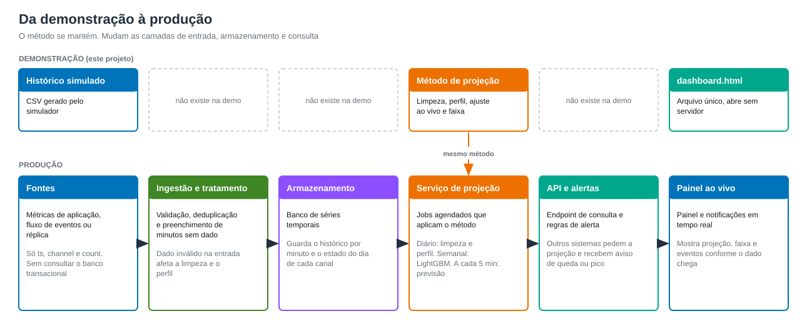
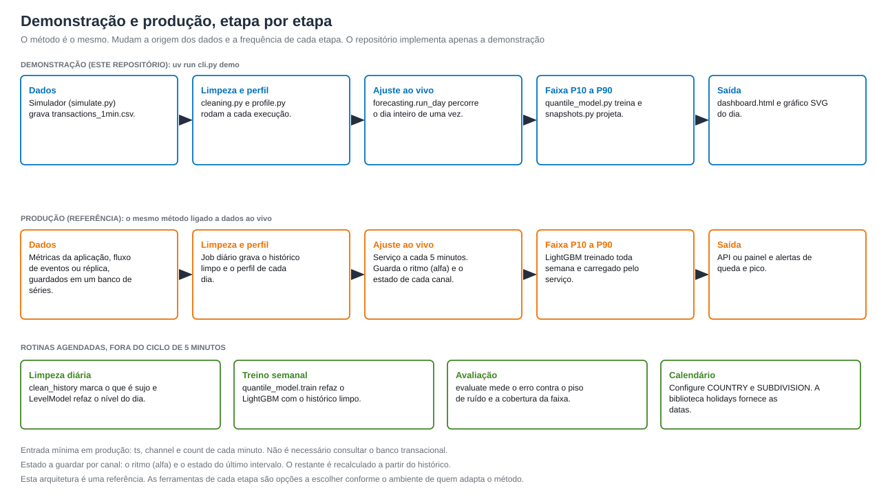
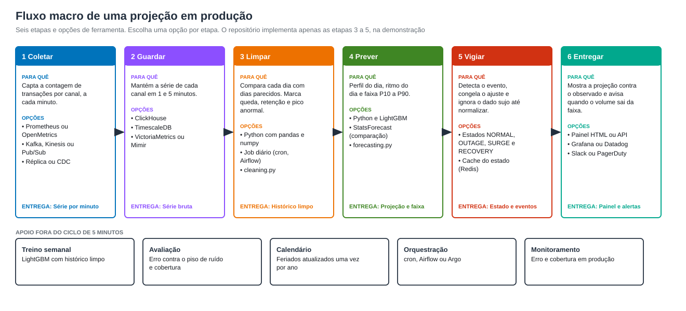

# Arquitetura e escolha do formato

O projeto é uma demonstração de como projetar dados futuros a partir de dados históricos, com contagens de transações de três canais fictícios.
Este documento descreve o formato de execução da demonstração e o caminho para ligá-la a dados reais. O repositório não implementa as camadas de produção descritas aqui. Elas servem como referência para quem quiser adaptar o método.

## Linha de comando, painel ou API

| Opção | Serve para | Vantagem | Limite |
|---|---|---|---|
| Linha de comando (`cli.py`) | executar, avaliar e ajustar | um comando por etapa, funciona em CI | não é visual |
| Painel HTML (`out/dashboard.html`) | entender e apresentar | arquivo único, abre com duplo clique, sem servidor | os dados ficam fixados na hora de gerar o arquivo. O painel abre em um horário "agora" inicial fixo, e as projeções não acompanham o relógio |
| API (não incluída) | ligar o modelo a dados ao vivo | consulta sob demanda por outros sistemas | exige servidor, autenticação e dados em tempo real |

Para a simulação, a escolha é linha de comando e painel estático. Todos os horários do dia são calculados antes: o modelo só olha para o
passado, então uma passada pelo dia contém o que seria visto em qualquer horário, e o navegador apenas desenha os gráficos. O painel pode ser enviado
por e-mail ou chat, sem infraestrutura.

## Como o código se organiza

```text
 CSV por minuto ──► data.py ──► pipeline.Forecaster ──► snapshots.py ──► dashboard.py ──► out/dashboard.html
                                 │  cleaning.py            │  quantile_model.py   report.py ──► out/projection_*.svg
                                 │  profile.py             │  (LightGBM)
                                 └  forecasting.py         └  day_ahead_band
```

`Forecaster` limpa o histórico e monta o perfil de cada dia. `forecasting.run_day` percorre o dia intervalo a intervalo, e `snapshots`
junta o ritmo do dia, o perfil e a faixa para cada horário "agora". O painel e o gráfico só desenham o resultado. O fluxo completo, com o
que cada etapa recebe e entrega, está em [METHOD.md](METHOD.md).

## Quando acrescentar uma API

Quando houver um fluxo de transações em tempo real para consultar. Um desenho simples:

```text
GET /forecast?channel=app
{
  "channel": "app", "as_of": "AAAA-MM-DDT15:30:00",
  "now_per_min": 161, "state": "NORMAL", "rhythm_vs_normal": 0.009,
  "next_5min": {"p10": 156, "p50": 163, "p90": 170},
  "rest_of_day": [{"ts": "15:35", "p10": 154, "p50": 162, "p90": 171}, ...]
}
```

O corpo é o que `snapshots.compute_snapshots` já calcula para cada horário. A API só precisa carregar o histórico, chamar essa função e
devolver o resultado em JSON.

## Da demonstração à produção





O mesmo desenho em fluxo macro, com as ferramentas possíveis de cada etapa:



| Etapa em produção | Frequência | Código deste projeto |
|---|---|---|
| Coletar e guardar a contagem por minuto (métricas, eventos ou réplica, num banco de séries) | contínua | substitui `data.py` e o CSV |
| Limpar o histórico e ajustar o nível do dia | diária | `cleaning.clean_history`, `profile.LevelModel` |
| Treinar a faixa de incerteza e conferir contra o histórico recente | semanal | `quantile_model.train`, `evaluate` |
| Prever, detectar eventos e publicar | a cada 5 minutos | `pipeline.Forecaster.profile_for`, `forecasting.run_day`, `snapshots` |
| Painel e alertas | contínua | `dashboard.py`, `report.py` (ou uma ferramenta de painéis já existente) |

Pontos de atenção na passagem para produção:

- **Fonte dos dados.** O modelo só precisa de `ts`, `channel` e `count` (veja [DATA.md](DATA.md)). Métricas de aplicação, um fluxo de eventos ou
  uma réplica servem. Não é preciso consultar o banco transacional.
- **Estado do dia.** `run_day` recebe o dia inteiro, mas só olha o passado de cada intervalo. Em produção, guarde o alfa e o estado do último
  intervalo (um registro por canal) e atualize a cada 5 minutos.
- **Feriados.** Configure `COUNTRY` e `SUBDIVISION` em `day_features.py`. A biblioteca `holidays` fornece os feriados dos anos que os dados cobrem.
- **Alertas.** Os sinais naturais são a diferença entre a projeção e o observado, e o estado `OUTAGE` ou `SURGE`. A perda estimada de um
  evento é a soma de (projeção menos observado) nos intervalos da queda.
- **Reavaliação.** Execute `evaluate` periodicamente sobre os dados reais mais recentes. Sem gabarito, use o erro contra o observado
  (comparado ao `noise_floor`) e a cobertura da faixa.
- **Contêiner.** O `Dockerfile` serve de base para a imagem do serviço. A imagem não guarda dados: `data/` e `out/` entram por volume.
