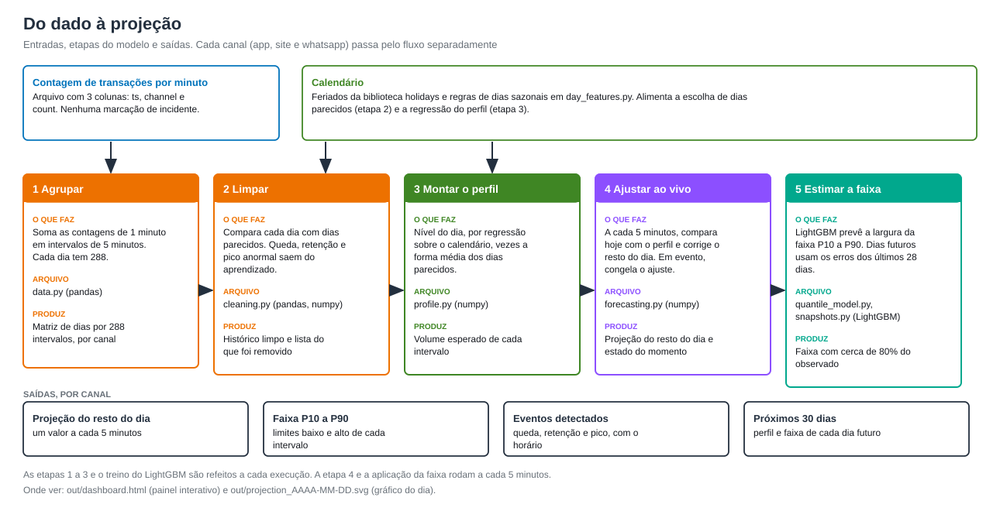
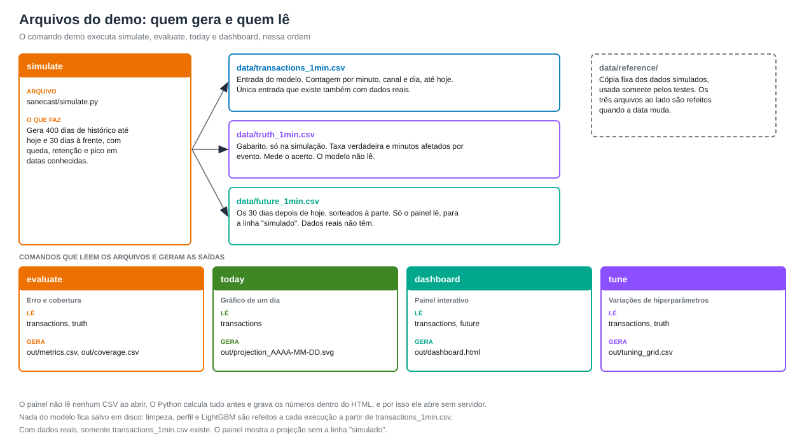

# Dados

O modelo precisa de uma única tabela: a contagem de eventos por minuto e por série. Na demonstração, são transações em três canais fictícios.
O modelo identifica sozinho o dado sujo, a sazonalidade e os eventos.



## Arquivos do projeto



Com dados reais só existe `data/transactions_1min.csv`. Os outros dois CSVs são da simulação. A tabela completa, com os arquivos de saída, está no
[README](../README.md#arquivos-gerados).

## Formato de entrada

Arquivo `data/transactions_1min.csv`, em UTF-8, com uma linha por canal e por minuto:

```csv
ts,channel,count
AAAA-MM-DD 14:05:00,app,1043
AAAA-MM-DD 14:05:00,site,201
AAAA-MM-DD 14:05:00,whatsapp,26
```

| Coluna | Tipo | Regra |
|---|---|---|
| `ts` | data e hora | início do minuto, sem fuso. Use o horário local de quem gerou os dados |
| `channel` | texto | nome da série. Na demonstração são os canais app, site e whatsapp. Cada série é prevista separadamente |
| `count` | inteiro | transações naquele minuto, maior ou igual a 0 |

Os minutos são somados em intervalos de 5 minutos (288 por dia). O arquivo só é aceito se todos os canais tiverem os dias completos.
Se faltar minuto ou sobrar dia parcial, o carregamento falha e informa qual canal está incompleto (`sanecast/data.py`).

## Quanto histórico é preciso

| Histórico | O que muda |
|---|---|
| Menos de 4 semanas | Não recomendado. Faltam dias parecidos para o perfil e para a limpeza. |
| 8 semanas | Mínimo para dias comuns. Feriados e vésperas ficam sem exemplo, e a regressão do nível usa somente o que já viu. |
| 14 meses ou mais | Recomendado. Cada dia sazonal do ano (feriados, Carnaval, Black Friday, fim de ano, férias) precisa aparecer ao menos uma vez para o modelo estimar o efeito dele. A simulação usa 400 dias. |

Dias sazonais raros (Natal, Carnaval) têm poucos exemplos. O nível vem de uma regressão, que combina efeitos conhecidos (por exemplo
feriado e início de mês), e a forma do dia vem dos exemplos que existirem (`shape_min_days`).

## O que ajustar para os seus dados

| Onde | O que | Motivo |
|---|---|---|
| `sanecast/day_features.py`, `COUNTRY` e `SUBDIVISION` | país e região dos feriados, que vêm da biblioteca `holidays` | o modelo não infere feriados. Sem essa configuração, o feriado é tratado como dia atípico |
| `sanecast/day_features.py`, `MONTH_START_DAYS` | dias sazonais de início de mês (padrão: 5 a 10) | o efeito de início de mês é estimado por dia do mês |
| `sanecast/config.py`, `Config` | limiares e janelas | cada parâmetro tem um comentário com o efeito |

## Dados sujos: o que o modelo espera encontrar

Nenhuma marcação é necessária. O modelo trata como sujo:

| Padrão | Como é detectado |
|---|---|
| Queda (incidente, indisponibilidade) | 3 intervalos seguidos (15 min) ou mais abaixo de 55% do esperado pelos dias parecidos. Sem limite de duração |
| Retenção (pico logo depois de uma queda) | continua enquanto o volume fica acima de 110% do esperado e termina quando 3 intervalos seguidos voltam abaixo disso |
| Pico anormal (novas tentativas, fraude, erro de contagem) | 3 intervalos seguidos ou mais acima de 145% do esperado. Sem limite de duração |

Início de mês, véspera, feriado e fim de semana não são tratados como sujos, porque os dias parecidos também têm esse volume.
Nenhuma duração é presumida: um incidente de 20 minutos e um de 4 horas passam pela mesma regra. No ajuste ao vivo o evento dura até o volume voltar ao normal ou até o
fim do dia. Uma mudança permanente de patamar (campanha, nova integração) não se distingue de um incidente longo. Na limpeza ela deixa de ser sujeira quando
os dias parecidos passam a mostrar o novo patamar, o que leva alguns dias.

## Gabarito do simulador

`data/truth_1min.csv` existe só com dados simulados e o modelo nunca o lê. Serve para medir o acerto:

```csv
ts,channel,expected,affected
AAAA-MM-DD 14:05:00,app,1027.3,1
```

| Coluna | Significado |
|---|---|
| `expected` | taxa verdadeira (transações por minuto) sem nenhum evento |
| `affected` | 1 se o minuto foi afetado por queda, retenção ou pico |

Com dados reais não há gabarito. `tune` e as colunas "contra a taxa verdadeira" de `evaluate` só funcionam com dados simulados. Para
dados reais, use o erro contra o observado e a cobertura da faixa, que não precisam do gabarito.

## Simulador

`uv run cli.py simulate` gera os últimos 400 dias (mais de um ano) até a data de hoje do computador, em três canais (200, 40 e 5 transações por minuto),
com semente fixa. Hoje é o último dia do histórico e o dia inteiro é simulado. O painel usa a parte depois do horário "agora" somente para comparar.

Os comandos `evaluate`, `today`, `dashboard` e `tune` geram os dados de novo quando encontram dados simulados de outro dia.
Os números de [RESULTS.md](RESULTS.md) vêm dos dados de referência (`data/reference/`, gerados com `REFERENCE_DAY` em `sanecast/simulate.py`).
Os testes usam sempre essa data de referência (`data/reference/`) e não mudam com o relógio.

O calendário acompanha a data. Os feriados vêm da biblioteca `holidays` (país e região em `COUNTRY` e `SUBDIVISION`, qualquer ano), com Carnaval e Corpus Christi
tratados como feriado. O modelo deriva os demais dias sazonais por regra: véspera, dia seguinte, ponte, fim de semana prolongado, início (dias 5 a 10),
meio (15 a 20) e fim de mês, Black Friday e Cyber Monday, datas comerciais, fim de ano, virada do ano e férias escolares. O simulador aplica um efeito a cada um
(`SEASONAL_EFFECTS`), e [RESULTS.md](RESULTS.md) mostra que a regressão recupera cada efeito. Os eventos acontecem sempre a tantos dias antes de hoje (`EVENTS`), então o histórico
tem os mesmos 26 eventos em qualquer data, em dias de calendário diferentes. Por isso os números variam um pouco de um dia para o outro.

O simulador também sorteia os 30 dias seguintes em `data/future_1min.csv`, com as colunas `ts,channel,count`. O modelo nunca lê esse arquivo.
O painel o usa para desenhar a linha "simulado" ao lado da projeção dos próximos dias. O sorteio é separado (`seed + 1`), então mudar a
janela futura não altera o histórico. O futuro simulado não tem eventos, porque eventos futuros não são previsíveis. Com dados reais esse
arquivo não existe, e o painel mostra só a projeção.

O nível do volume oscila devagar ao longo do dia (4%, com memória de cerca de 3 horas), o que torna parte da variação imprevisível.
Os eventos duram de 20 minutos a 4 horas e a retenção dura em proporção à queda. São 18 quedas com retenção e 8 picos anormais. Na data de referência parte deles cai em dias
sazonais altos (início de mês e feriado), para verificar que o modelo não confunde sazonal com sujeira. A lista está em `sanecast/simulate.py`.
