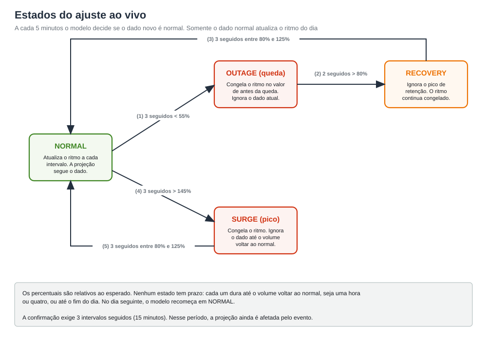

# Método

Este documento descreve como o projeto projeta dados futuros a partir do histórico e o motivo de cada escolha, na ordem em que os dados
passam pelo modelo. O exemplo usa a contagem de transações por minuto de três canais fictícios (app, site e whatsapp).
Cada seção aponta o arquivo que implementa o passo. Os números ajustáveis estão em `sanecast/config.py`.


Vocabulário usado nestes documentos:

| Termo | Significado |
|---|---|
| intervalo | trecho de 5 minutos. Cada dia tem 288. No código aparece como `bin` |
| perfil | o dia esperado: volume que o modelo espera em cada intervalo, antes de ver o dia |
| ritmo do dia (alfa) | quanto o dia está acima ou abaixo do perfil, medido nas últimas horas |
| dia sazonal | dia com volume diferente do normal por causa do calendário: fim de semana, feriado, véspera, dia seguinte, ponte, fim de semana prolongado, início, meio e fim de mês, Carnaval, Black Friday, datas comerciais, fim de ano e férias escolares |
| evento | queda, retenção ou pico anormal |
| retenção | pico logo depois de uma queda, quando as transações represadas chegam juntas |
| faixa P10 a P90 | intervalo onde o modelo espera encontrar 80% dos valores |
| piso de ruído | menor erro possível, o de uma previsão perfeita, por causa da variação ao acaso das contagens |

## Quando o modelo se adapta


A limpeza, o dia esperado e o LightGBM são refeitos a cada execução com o histórico até ontem. O ritmo do dia se atualiza a cada 5 minutos.
Limiares, calendário e hiperparâmetros mudam somente por decisão de quem mantém o projeto.

## 1. Dados e ruído de contagem

As transações de um intervalo seguem aproximadamente uma distribuição de Poisson em torno de uma taxa verdadeira `λ`:
o desvio padrão é `√λ`. Dessa propriedade decorre o princípio que orienta o resto do projeto.

> Mesmo conhecendo `λ`, a previsão erra. O erro esperado de uma previsão perfeita é `E|contagem − λ| ≈ √(2λ/π) ≈ 0,8·√λ`
> por intervalo, ou `0,8 / √λ` em termos relativos.

| Canal | `λ` por intervalo de 5 min (média) | Piso de erro (WAPE contra o observado) |
|---|---|---|
| app | cerca de 1.000 | cerca de 2,2% |
| site | cerca de 200 | cerca de 5,0% |
| whatsapp | cerca de 25 | cerca de 14,3% |

Por isso o erro é medido de duas formas (`sanecast/evaluate.py`):

- contra o observado (`wape_obs`): é o que um painel mostraria e tem o piso acima, que nenhum modelo vence;
- contra a taxa verdadeira (`wape_exp`): só existe na simulação, mede o erro do modelo sem o ruído e decide se uma mudança melhora a previsão.

WAPE é `soma(|alvo − previsão|) / soma(alvo)`.

## 2. Limpeza do histórico (`cleaning.py`)

A limpeza identifica quais intervalos estão sujos, sem receber marcação, e os exclui do aprendizado. Sujo é o que os dias
parecidos pelo calendário não explicam. Volume alto que eles também mostram (início de mês, véspera de feriado) é sazonal e permanece.


Para cada dia `d` do histórico:

1. **Referência.** Mediana dos `cleaning_k` (7) dias mais parecidos, sem o próprio dia `d`. A mediana é pouco sensível à sujeira que ainda não foi marcada.
2. **Nível do dia.** A referência é multiplicada pela mediana de `y[d] / referência` entre 05h e 23h. A mediana ignora um evento que ocupe menos da metade do trecho. Na segunda passada, a mediana usa somente os intervalos restantes, o que impede que uma queda longa reduza o nível.
3. **Razão suavizada.** Média móvel de 3 intervalos de `y[d] / referência`.
4. **Marcação.** Intervalos com referência abaixo de 15 transações são ignorados, porque o ruído é grande demais para julgar.
   - Queda: razão abaixo de 0,55 por 3 intervalos seguidos ou mais (15 minutos ou mais, sem limite de duração). Marca esses intervalos e o anterior.
   - Retenção: depois de uma queda, continua enquanto a razão fica acima de 1,10 (`retention_exit_ratio`) e termina quando 3 intervalos seguidos voltam abaixo disso, mais 2 intervalos de margem (`retention_margin_bins`). Nenhuma duração é presumida.
   - Pico anormal: razão acima de 1,45 por 3 intervalos seguidos ou mais, também sem limite de duração.
5. **Segunda passada.** Repete tudo com a referência calculada sem os trechos achados na primeira, e com o nível do dia medido só nos intervalos que sobraram. Sem isso, um evento no dia vizinho distorce a referência e um evento longo distorce o nível.

Dias com mais de 30% dos intervalos marcados saem da base de dias parecidos (`max_dirty_fraction`).

A exigência de 3 intervalos seguidos evita falsos alarmes: no whatsapp, com cerca de 25 transações por intervalo, um único intervalo
abaixo do esperado ocorre por ruído. Três seguidos abaixo de 55% são raros, e eventos de 15 minutos ou mais são detectados. Os limiares foram
escolhidos para os dados simulados (veja os limites em [RESULTS.md](RESULTS.md)).

## 3. Perfil do dia: nível e forma (`profile.py`)

O perfil `P(b)` é o volume esperado do intervalo `b`, antes de ver o dia. Ele é o produto de duas partes estimadas separadamente.

### 3.1 Nível do dia: regressão log-linear (`LevelModel`)

Para cada dia limpo, o nível `L_d` é a mediana de `y[d,b] / referência_global(b)` no trecho diurno. Depois:

```text
log L_d = β0 + β_dow[dia da semana] + Σ β_marca · marca(d)        (14 marcas de dia sazonal, em `FLAGS`)
          + β_início_de_mês[dia do mês] (só no início de mês) + β_t·t + ε,      ε ~ N(0, σ²)
```

O ajuste usa mínimos quadrados com uma penalidade ridge pequena (`1e-3`) em tudo, menos no intercepto.

A regressão estima o nível porque os efeitos de calendário se multiplicam. Dois dias sazonais podem coincidir, como um feriado no início do mês, e o dia tem os dois efeitos.
A escolha do "dia mais parecido" não reproduz essa combinação e, quando encontra um único exemplo, ele traz os dois efeitos de uma vez.
Esse método gerou um erro de 41% em um feriado antes da mudança. Em escala log os efeitos se somam, então a regressão combina o que nunca
apareceu junto. O teste `test_level_model_combines_effects_never_seen_together` cobre o caso.

### 3.2 Forma: média dos dias parecidos

A forma é a média, intervalo a intervalo, dos dias parecidos divididos pelo nível de cada um:

```text
forma(b) = média, nos dias parecidos e, de  y[e,b] / L_e
P(b)     = forma(b) · L̂_d                  (L̂_d vem da regressão)
```

Os dias parecidos são os de menor `day_distance` (`day_features.py`):

| Diferença entre os dias | Peso |
|---|---|
| uma marca de dia sazonal difere (`FLAG_WEIGHTS`): feriado, Carnaval, Black Friday e Cyber Monday 3; véspera e ponte 2; dia seguinte e fim de semana prolongado 1,5; data comercial 1; fim de ano, fim de mês, férias escolares e meio de mês de 0,3 a 0,5 | o peso da marca, uma vez por marca |
| dia da semana | 0 se igual, 0,8 se ambos úteis ou ambos de fim de semana, 2 nos demais casos |
| início de mês | 0,2 por dia de diferença no dia do mês, até 1. Se só um dos dois está no início do mês, 0,5 |
| distância no tempo | 0,001 por dia, só para desempatar a favor do mais recente |

Entram os dias até `similarity_margin` (0,3) de distância do melhor, no máximo `profile_k` (20). Se houver menos de `shape_min_days` (5),
a margem cresce até alcançar, porque feriados são raros.

### 3.3 Suavização no tempo

A curva real é suave, então os intervalos vizinhos reduzem o ruído de contagem. A janela fixa é de 5 intervalos e cresce onde há poucas
transações (`smooth_target_count`): cobre o necessário para juntar cerca de 4.000 transações por estimativa, entre a janela fixa e 9 intervalos.
O app quase não é suavizado e o whatsapp é mais.

## 4. Previsão dentro do dia (`forecasting.py`)

### 4.1 Ritmo do dia (alfa)

A cada intervalo `t`, depois de observar `obs(t)`, o modelo mede o ritmo do dia contra o perfil numa janela dos últimos intervalos.
A janela junta cerca de `alpha_target_count` (3.000) transações esperadas, entre `alpha_min_window` (6) e `alpha_max_window` (72)
intervalos. Fica curta nos canais grandes e longa nos pequenos.

```text
α(t) = ( Σ obs + P·α(t−1) ) / ( Σ perfil + P ),         P = alpha_prior_bins · média(perfil)
```

A soma usa só os intervalos válidos da janela, sem evento. É uma média a posteriori Gamma-Poisson: com pouco volume o alfa fica perto
do valor anterior, e com muito volume segue os dados.

### 4.2 Previsão

```text
previsão(t+h) = ( 1 + (α(t) − 1) · exp(−h / τ) ) · P(t+h),         τ = alpha_tau (24 intervalos = 2 h)
```

O efeito do alfa diminui com o horizonte. Em 5 minutos ele vale quase inteiro, em 2 horas vale 37%, e depois disso o dia volta ao perfil.

### 4.3 Estados: o dado sujo nunca atualiza o alfa



A razão do momento é `razão(t) = obs(t) / (α_ref · P(t))`, onde `α_ref` é o alfa corrente (ou o congelado, fora do estado normal).

| Estado | Entra quando | Sai quando | O que faz |
|---|---|---|---|
| NORMAL | início do dia | só pelas transições abaixo | atualiza o alfa |
| OUTAGE | 3 intervalos seguidos com razão abaixo de 0,55 | 2 seguidos acima de 0,8 vão para RECOVERY | congela o alfa de antes da queda |
| SURGE | 3 intervalos seguidos com razão acima de 1,45 | 3 seguidos entre 0,8 e 1,25 voltam a NORMAL | congela o alfa |
| RECOVERY | fim da queda | 3 seguidos entre 0,8 e 1,25 voltam a NORMAL | ignora o pico de retenção |

Nenhum estado tem prazo: cada um dura até o volume voltar ao normal ou até o fim do dia (`max_event_bins`). No dia seguinte a máquina recomeça em NORMAL.

O alfa congelado é o de 3 intervalos antes da confirmação, para não incluir os que já estavam em queda. Os intervalos do evento e os 2
anteriores ao gatilho ficam inválidos para o cálculo do alfa. Durante um incidente a projeção continua no nível que o dia teria sem
ele, e a retenção posterior não é incorporada como novo patamar.

A confirmação exige 3 intervalos (15 minutos). Nesse período a previsão ainda é afetada pelo evento.

## 5. Faixa de incerteza (`quantile_model.py`, `snapshots.py`)

### 5.1 LightGBM quantílico

O modelo prevê a razão `y(t+h) / P(t+h)`, e não a contagem. Há um modelo por quantil (P10, P50, P90), o mesmo para todos os canais.
A perda é a pinball: `L_q = max(q·(y−ŷ), (q−1)·(y−ŷ))`.

Atributos: alfa, razões observado/perfil nas janelas de 1, 3, 6 e 12 intervalos, horizonte, `log(1+P)`, seno e cosseno da hora do intervalo previsto,
dia da semana, feriado, véspera, dia seguinte, ponte, fim de semana prolongado, início e fim de mês e canal (categórico).

Regras que impedem o dado sujo de contaminar o modelo de ML:

- só entram no treino as linhas com estado NORMAL e sem intervalo marcado como sujo, nem no atributo nem no alvo;
- o perfil de cada dia de treino é calculado sem o próprio dia, para o modelo não ver a resposta;
- em OUTAGE, SURGE ou RECOVERY os atributos chegam neutros (razão 1). O centro da faixa vem do modelo base com o alfa congelado,
  e o LightGBM informa só a largura relativa.

### 5.2 Faixa para o resto do dia

O LightGBM é medido em 5 minutos e 1 hora. Para horizontes maiores:

```text
largura(h) = interpolação entre 5 min e 1 h                           se h ≤ 12 intervalos
largura(h) = largura(12) · (h / 12) ^ band_growth_exponent            se h > 12 intervalos    (expoente 0,2)
```

O expoente foi calibrado medindo a cobertura em vários horários (veja [RESULTS.md](RESULTS.md)).

### 5.3 Dias à frente (`snapshots.day_ahead_band`)

Para amanhã e os dias seguintes não há dado do dia. A projeção é o perfil (seção 3) calculado com o calendário do dia
(`Forecaster.profile_of`). Não existe alfa e o LightGBM não se aplica. A faixa vem direto do histórico:

```text
razão(d, b) = y(d, b) / P(d, b)        últimos 28 dias limpos, com P calculado sem o próprio dia
P10 e P90   = quantis de razão(·, b ± 6)        um par para cada intervalo do dia
faixa(b)    = [P10(b) · P(b), P90(b) · P(b)]
```

Cada intervalo usa os 6 vizinhos de cada lado porque o ruído muda ao longo do dia: de madrugada o volume é pequeno e a razão varia mais.
A faixa já inclui o erro do nível do dia e a oscilação lenta do volume. Medida nos últimos 14 dias do histórico, usando só os dias
anteriores a cada um, a cobertura ficou entre 77% e 80%, conforme o canal, para um alvo de 80%. O teste
`test_day_ahead_band_covers_about_80_percent_without_seeing_the_day` exige entre 70% e 90%.

Quanto mais longe o dia, mais a projeção depende da tendência extrapolada (0,1% ao dia na simulação) e menos dos dias recentes.
Feriados raros têm poucos exemplos. Em um feriado a 30 dias de distância, o app ficou 7% abaixo do projetado. É um único dia e
não foi medido em vários.

## 6. Avaliação (`evaluate.py`, `workflow.py`)


- **Cenários:** `normal`, `month_start` (início de mês), `holiday` (feriado), `special` (véspera, dia seguinte, ponte, fim de semana prolongado, Carnaval, Black Friday, Cyber Monday, data comercial e virada do ano) e `event` (intervalos afetados por queda, retenção ou pico).
  Em `event` o alvo é a taxa verdadeira, o que teria acontecido, e não o observado sujo.
- **Modelos de comparação:** `no_cleaning` (o mesmo modelo sem limpeza), `last_week` (o mesmo intervalo 7 dias antes),
  `statsforecast_seasonal_naive` e `statsforecast_mstl` (ajustados no histórico limpo).
- **Sem espiar o futuro:** para prever um dia só entram dias anteriores ao início do período avaliado.
- **Ajuste dos parâmetros:** `tuning.py` escolhe numa janela de validação (dias 50 a 21 antes do último dia dos dados) e confere na de teste (últimos 20 dias).

## Calendário: todos os dias que mudam o comportamento (`day_features.py`)

Cada dia recebe marcas (`FLAGS`) que entram em três lugares: na regressão do nível (um efeito multiplicativo por marca), na escolha dos dias parecidos
(o peso da marca em `day_distance`) e nos atributos do LightGBM (as marcas de feriado e arredores). As marcas:

| Marca | Quando vale |
|---|---|
| `holiday` | feriado da biblioteca `holidays` (país e região em `COUNTRY` e `SUBDIVISION`), mais Carnaval e Corpus Christi |
| `eve`, `post` | dia útil antes ou depois de um feriado, quando não é ponte |
| `bridge` | segunda antes de feriado de terça, ou sexta depois de feriado de quinta |
| `long_weekend` | sábado ou domingo em uma sequência de 3 ou mais dias sem expediente |
| `carnival` | de sábado a quarta-feira de cinzas |
| `black_friday`, `cyber_monday` | 4ª sexta-feira de novembro e a segunda seguinte |
| `commercial` | Dia do Consumidor, Dia das Mães, Dia dos Namorados e Dia dos Pais |
| `month_end`, `mid_month` | últimos 2 dias do mês e dias 15 a 20 (início de mês, dias 5 a 10, tem um efeito por dia do mês) |
| `year_end`, `new_year` | 1 a 23 de dezembro e 27 de dezembro a 2 de janeiro |
| `school_break` | julho e de 3 a 31 de janeiro |

O fim de semana comum já entra pelo dia da semana. O modelo só aprende o efeito de uma marca se ela aparece no histórico. Uma marca que nunca apareceu
fica com efeito zero (a penalidade ridge a mantém em 1 na escala do nível), e o dia é tratado como comum. Por isso o histórico recomendado passa de um ano.
Para outro país, troque `COUNTRY` e revise as regras de Black Friday, datas comerciais e férias.

## Granularidade do painel (`templates/dashboard.html`)

O modelo trabalha em intervalos de 5 minutos. O painel mostra o resultado de 1 minuto a 1 dia (botões 1 min, 5 min, 15 min, 30 min, 1 h, 6 h e 1 dia, com 5 min
como padrão). O eixo é sempre em transações por minuto, e a dica do gráfico mostra também o total do bloco.

- Observado: em 1 minuto usa a contagem por minuto (`real1` no JSON do painel). Nos outros tamanhos soma os intervalos de 5 minutos.
- Projeção: em 1 minuto cada intervalo de 5 minutos vale para os seus 5 minutos (degrau), com o valor dividido por 5. Nos blocos maiores, soma os intervalos.
- Faixa: o ruído de contagem pesa mais em blocos pequenos, então a faixa muda com o tamanho. Para um intervalo `i` com projeção `p_i`, a faixa original
  dá `sd_i = (hi_i − lo_i) / (2 · 1,2816)` e a parte de incerteza do nível `rel_i = √max(sd_i² − p_i, 0) / p_i`. Para um bloco que soma `μ = Σ p_i`:
  `sd_bloco = √( (Σ rel_i · p_i)² + μ )`, e a faixa é `μ ± 1,2816 · sd_bloco`. A incerteza do nível se soma por inteiro, porque o erro de nível é o mesmo em
  todo o bloco, e o ruído de contagem se soma como variância. Em 5 minutos a conta reproduz a faixa original. Em 1 minuto o ruído domina, e em 1 dia
  domina o nível.
- Horários "agora": no dia de referência, de 5 em 5 minutos até 23:55. Nos dias passados, de 30 em 30 minutos mais o 23:55. Depois das 22:55 a faixa usa só o horizonte
  de 5 minutos. Às 23:55 não resta intervalo para projetar.

## 7. Hiperparâmetros

Todos ficam em `Config` (`sanecast/config.py`). Os principais:

| Parâmetro | Padrão | Efeito |
|---|---|---|
| `profile_k` | 20 | máximo de dias parecidos para a forma |
| `similarity_margin` | 0,3 | só entram dias até essa distância do melhor |
| `shape_min_days` | 5 | mínimo de dias para estimar a forma (a margem cresce até alcançar) |
| `smooth_window`, `smooth_target_count` | 5, 4000 | suavização no tempo, adaptada ao volume |
| `cleaning_k` | 7 | dias parecidos na referência da limpeza |
| `low_ratio`, `high_ratio` | 0,55, 1,45 | limiares de queda e de pico anormal |
| `min_run_bins` | 3 | intervalos seguidos para confirmar um evento (15 min) |
| `retention_exit_ratio`, `retention_margin_bins` | 1,10, 2 | a retenção termina quando a razão fica abaixo de 1,10 por `min_run_bins` intervalos, mais 2 de margem |
| `max_event_bins` | 288 | duração máxima de um estado de evento, em intervalos (um dia) |
| `alpha_target_count`, `alpha_min_window`, `alpha_max_window` | 3000, 6, 72 | transações que a janela do alfa deve juntar e seus limites, em intervalos |
| `alpha_prior_bins`, `alpha_tau` | 6, 24 | peso do alfa anterior e queda do efeito do alfa com o horizonte |
| `band_growth_exponent` | 0,2 | crescimento da faixa depois de 1 h |
| `horizons` | (1, 12) | horizontes medidos pelo LightGBM, em intervalos |

Para testar uma variação, use `Config(profile_k=15)` ou acrescente uma linha em `GRID` (`sanecast/tuning.py`) e execute `uv run cli.py tune`.
